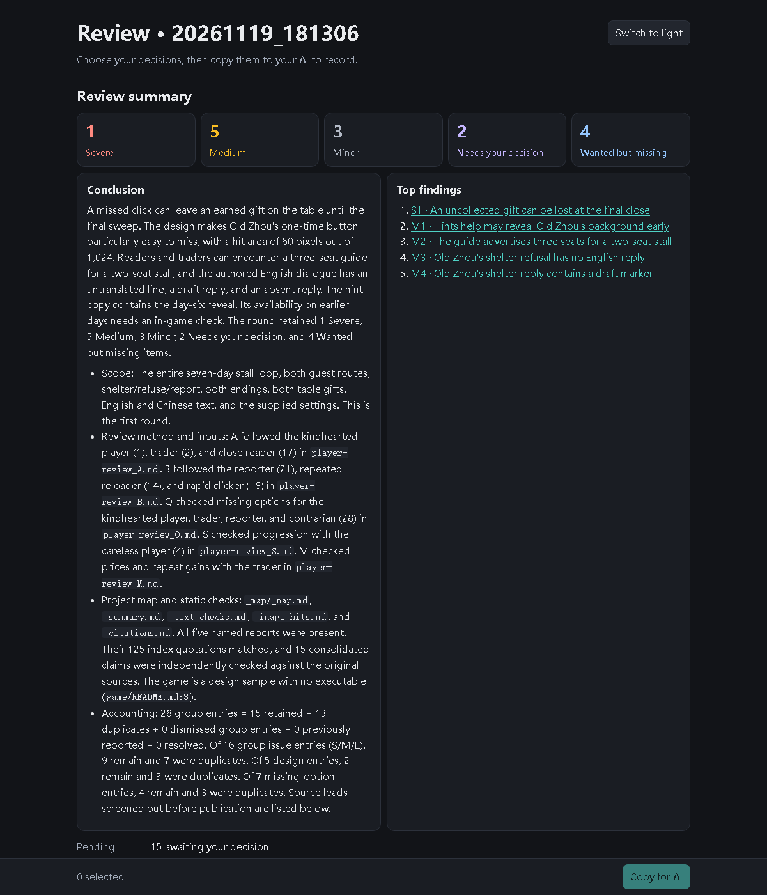

# AI Review (AI 审核)
[中文](README.md) | English  
Review your game from the players' point of view.

The toolkit is called PlayerReviewKit internally. It gives your AI assistant a process for reading the game's code, data, and text to find issues different players might encounter and options they might want.

```text
Simulate different players → Collect feedback → Decide what to do → Make changes → Check the changes in the next round
```

## Getting started

1. Download or clone the `ai-player-review` repository.
2. Open your AI assistant in your game project (Claude Code, Codex, Cursor, Gemini CLI, or Copilot CLI, for example). Say `Read AGENTS.md in <kit folder> and set it up for me.`
3. Next time, say `Review this game from the players' point of view.` You can also name an area to review.

On first use, the assistant asks where the game is and where to put reports.
It follows the review tasks and gives you a page you can open offline.
Choose what to do about each item, click **Copy for AI**, and paste the decisions into the chat.

## What you get

- Feedback from players who take different approaches to the game.
- Issues they could run into, such as instructions that don't match what happens.
- Missing options, settings, or responses players might want.
- Things the game already does well.

Each item cites its source. You can see two examples for Tea Stall, a fictional mini-game.

- [Handwritten sample report](eval/tea-stall/sample_round/玩家视角审查_合并.md)
- [A round run by an AI assistant in English](eval/tea-stall/real_round_en/), with a merged report (`player-review_merged.md`) and a page (`review.html`). The assistant followed the documentation in a chat, ran five review groups, and merged the reports. We shared this run regardless of the outcome. There is also [the same kind of round in Chinese](eval/tea-stall/real_round/).



## Language

During setup, the assistant asks whether you want Chinese or English. Set the project language to English to get English reports, the one-page summary, the offline page, the fix list, decision records, cost records, and review conversations. The documentation and review materials are mainly in Chinese, including the player personas and review methods. The assistant can read them directly.

## Requirements, cost, and privacy

- You need Windows, Python 3.8 or later, and an AI assistant that can read files and run commands. Other operating systems have yet to be tested.
- Reviews in chat use your current session's allowance. Background jobs can use a subscription or pay-as-you-go billing. The assistant gives you an estimate before starting, if prior usage data is available.
- Reviews are read-only. The assistant you already use reads the game's code and text. In-chat reviews require no API key, and reports stay in your project's output folder.

## What needs playtesting

Ask real players to judge how the game looks, feels, and plays. For issues that need an in-game check, the report gives you steps to verify them.

## Testing so far

Codex CLI completed a full in-chat cycle on Tea Stall. It ran five review groups, merged the reports, recorded decisions, fixed one issue, and checked it again. It also ran one full round on an English project: English reports, page, decisions, and fix list. Antigravity (Gemini) reached the stage before merging. Repeat-round evaluations, other tools, and real games have yet to be systematically tested.

## More

- [Usage in Chinese](docs/usage.md) · [Design and testing in Chinese](docs/design.md) · [References](docs/references.md)
- Start with the English section of [AGENTS.md](AGENTS.md#english) for the [English instructions for AI assistants](for-ai/en/).

Licensed under [MIT](LICENSE).
