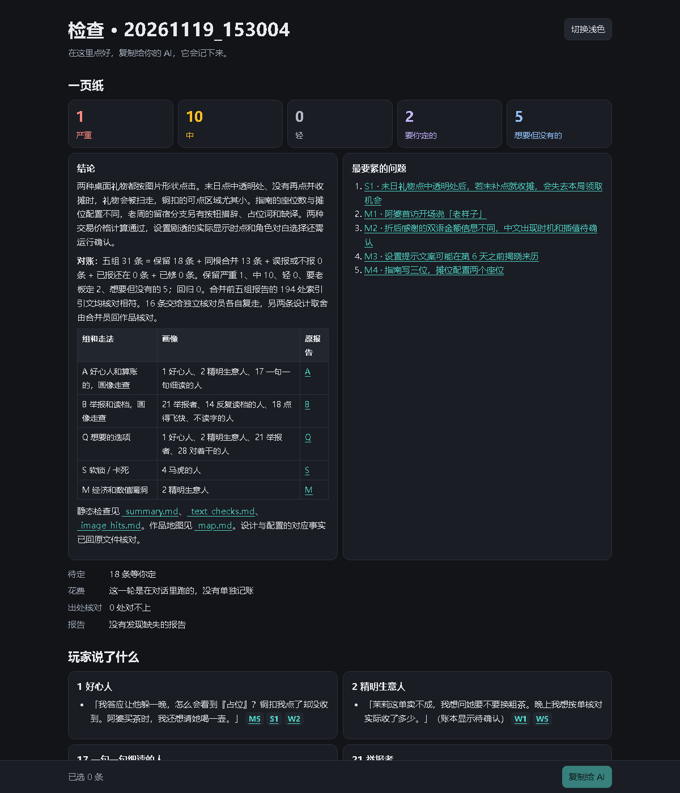

# AI 审核
中文 | [English](README.en.md)  
给游戏做玩家视角审查。

工具包内部叫 PlayerReviewKit。让你的 AI 读游戏的代码、数据和文本，提前找出不同玩家可能遇到的问题和想要的选项。

```text
模拟不同的玩家去玩 → 他们的反馈 → 负责人决定 → 改作品 → 再来一轮（先核上一轮的反馈改好了没有）
```

## 怎么用

1. 下载或克隆 `ai-player-review` 仓库。
2. 在你的游戏项目里打开 AI 助手（Claude Code、Codex、Cursor、Gemini CLI、Copilot CLI 等），对它说：「读 `<工具包文件夹>` 里的 AGENTS.md，帮我装好。」
3. 以后对它说：「从玩家视角审查一下。」也可以点名要看的地方。

第一次用，AI 会问几个问题，比如游戏在哪、报告放哪。
它会照任务文件审查，做完交给你一个能离线打开的页面。
在页面上点选每条怎么处理，点「复制给 AI」，贴回对话。

## 你会得到什么

- 玩家反馈，按不同玩家的做法来写。
- 他们可能碰到的问题，比如提示和实际结果对不上。
- 他们想要但游戏没给的选项、设置或反应。
- 游戏已经做对了的地方。

每条带出处。可以先看虚构小游戏「茶摊」的两个例子。

- [手写示范报告](eval/tea-stall/sample_round/玩家视角审查_合并.md)
- [模型实际跑出的一轮](eval/tea-stall/real_round/)，里头有合并报告 `玩家视角审查_合并.md` 和页面 `review.html`。一个 AI 助手照文档在对话里跑了五组审查员和合并。这轮没有按结果好坏挑选。



## 语言

第一次装时，AI 会问用中文还是英文。选英文，报告、一页纸、离线页面、待修清单、决定记录、花费表和审查对话都用英文。文档和工具包里的资料以中文为主，比如画像库和走法，AI 能直接读。

## 环境、花费和隐私

- 需要 Windows、Python 3.8 或更新版本，以及能读文件和跑命令的 AI 助手。其他系统没有试过。
- 对话里审查用你这场会话的额度。想后台跑，可用会员额度或按次付费，开跑前会先给估价。没有历史数据时会说明估不了。
- 审查只读。作品代码和文本由你自己用的 AI 读取。对话内审查无需读取密钥，报告留在项目的输出文件夹。

## 做不到什么

画面、手感和好不好玩要靠真人试玩。要运行游戏才能确定的问题，会写测试步骤给你核实。

## 现在到哪了

在茶摊上用 Codex CLI 在对话里跑过一整圈，做了五组审查、合并、记决定、修一条和复查；又用英文项目完整跑过一轮，报告、页面、决定和待修清单都是英文（[英文的那一轮](eval/tea-stall/real_round_en/)）。用 Antigravity（Gemini）跑到合并之前。多轮评测、其他工具和真作品还没系统验证。

## 更多

- [详细用法](docs/usage.md) · [设计和验证范围](docs/design.md) · [参考文献](docs/references.md)
- 给 AI 的说明在 [for-ai/](for-ai/)，从 [AGENTS.md](AGENTS.md) 进。

许可证为 [MIT](LICENSE)。
